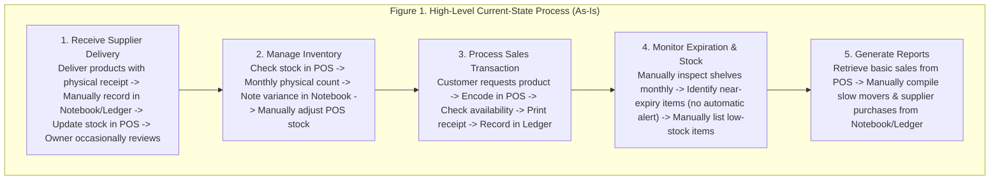
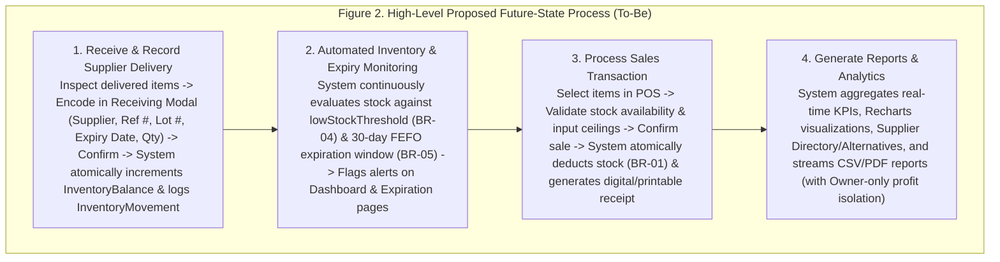
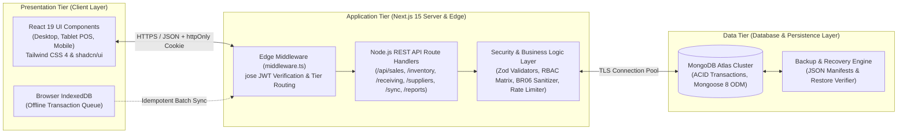
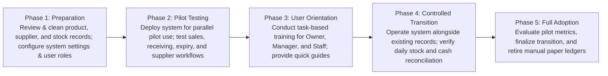

# AGRIVET SALES, INVENTORY, AND SUPPLIER MANAGEMENT SYSTEM
**A Business Process Improvement and Information System Plan for Agrivet Retail Operations**

A BAM – 285 Final Course Work  
Presented to the Faculty of the College of Information Technology Education  
Phinma University of Iloilo  
Rizal, Iloilo City, Philippines  

In Partial Fulfillment of the Requirements for the Degree  
**Bachelor of Science in Information Technology**  

**By:**  
De Asis, Neil Mar  
Ferwin Khen Hautea  
Gian Rovik Somes  
Jayson Sapio  
Jesmond Sardiniola  
Jo Vincent Beldad  
John Arvy Lopez  
John Lloyd Cabanig  
Buenafe, Nelmar  
Enagada, Kin  

**Concurred:**  
Jireh Flavio, MSCS — BAM-285 Project Lead  
Seth D. Nono — Dean, College of Information Technology Education  

October 2026

---

# EXECUTIVE SUMMARY

The target poultry supply business has operated for approximately four to six years and handles an estimated 51 to 100 customer transactions on a typical day. The business already uses a Point-of-Sale (POS) system together with notebook or ledger records for selected activities. However, the client assessment identified continuing operational concerns involving inventory accuracy, product availability, expiration monitoring, stock receiving, supplier information, and access to management information.

The owner reported frequent differences between recorded stock and actual physical inventory, occasional product stockouts, monthly physical inventory counting, and damaged, lost, or unaccounted items. Products with expiration dates are sold, but no formal expiration-monitoring method is currently used. Supplier contact information and purchase histories are mainly maintained through a phone contact list, while receiving stock and reordering from suppliers were identified among the most time-consuming business activities. Supplier management, particularly supplier stock availability and delivery updates, was identified as an area needing improvement.

The proposed Agrivet Sales, Inventory, and Supplier Management System is intended to improve and integrate these business processes rather than simply replace an existing POS. The proposed solution centralizes relevant sales, inventory, stock receiving, expiration, and supplier information; supports low-stock and expiration monitoring; improves access to operational summaries; applies strict role-based and multi-tenant access restrictions; and provides mechanisms for protecting and recovering business records. The project utilizes structured business analysis techniques to document the current process, define requirements, design the future-state process, and evaluate the working full-stack application within the academic project period.

---

# TABLE OF CONTENTS

* **EXECUTIVE SUMMARY**
* **LIST OF TABLES**
* **LIST OF FIGURES**
* **CHAPTER I: INTRODUCTION**
  * 1.1 Background of the Project
  * 1.2 Statement of the Problem
    * 1.2.1 General Problem
    * 1.2.2 Specific Problems
  * 1.3 Objectives of the Project
    * 1.3.1 General Objective
    * 1.3.2 Specific Objectives
  * 1.4 Significance of the Project
  * 1.5 Purpose and Description
  * 1.6 Scope and Limitations
    * Scope
    * Limitations
* **CHAPTER II: REVIEW OF RELATED LITERATURE AND SYSTEMS**
  * 2.1 Related Literature
  * 2.2 Related Systems
  * 2.3 Synthesis
  * References
* **CHAPTER III: METHODOLOGY**
  * 3.1 Requirements Analysis
    * 3.1.1 Stakeholder Analysis
    * 3.1.2 Client Assessment Results
    * 3.1.3 Current-State Process (As-Is)
    * 3.1.4 Problems Identified
    * 3.1.5 Root-Cause Analysis (4P Diagnostic)
    * 3.1.6 Requirements Engineering
  * 3.2 Framework of the Project
    * 3.2.1 Proposed Future-State Process (To-Be)
    * 3.2.2 Before-and-After Process Comparison
    * 3.2.3 Proposed System Modules
    * 3.2.4 Business Rules
    * 3.2.5 Data Model Specification
    * 3.2.6 System Architecture
    * 3.2.7 Feasibility and Justification
    * 3.2.8 Requirements Traceability and Scope Control
  * 3.3 Prototype Development and Validation Plan
    * 3.3.1 Prototype Scope
    * 3.3.2 Client Validation
    * 3.3.3 Planned Validation Scenarios
    * 3.3.4 Scope of Testing
  * 3.4 Proposed Implementation Plan
    * 3.4.1 Proposed Transition Approach
    * 3.4.2 Proposed Training and Data Preparation
    * 3.4.3 Proposed Four-Week Project Schedule
    * 3.4.4 Future Production Implementation
* **CHAPTER IV: RESULTS AND DISCUSSION**
  * 4.1 Implementation Development Tools
  * 4.2 Hardware Requirements
  * 4.3 Software Requirements
  * 4.4 Input and Outputs of the Study
  * 4.5 Results Interpretation and Analysis
  * 4.6 System Evaluation Results
* **CHAPTER V: CONCLUSION AND RECOMMENDATIONS**
  * 5.1 Introduction
  * 5.2 Summary of the Proposed Study Design and Implementation
  * 5.3 Summary of Findings
  * 5.4 Conclusion
  * 5.5 Recommendations

---

# LIST OF TABLES

* **Table 1.** Related Systems
* **Table 2.** Stakeholder Analysis
* **Table 3.** Client Assessment Results
* **Table 4.** Problems Identified
* **Table 5.** Functional Requirements
* **Table 6.** Non-Functional Requirements
* **Table 7.** Before-and-After Process Comparison
* **Table 8.** Business Rules
* **Table 9.** Data Model Specification
* **Table 10.** Feasibility and Justification
* **Table 11.** Requirements Traceability and Scope Control
* **Table 12.** Planned Validation Scenarios
* **Table 13.** ISO/IEC 25010 System Evaluation Summary

# LIST OF FIGURES

* **Figure 1.** High-Level Current-State Process (As-Is)
* **Figure 2.** High-Level Proposed Future-State Process (To-Be)
* **Figure 3.** Three-Tier System Architecture
* **Figure 4.** Planned Validation Scenarios
* **Figure 5.** Proposed Implementation Phases
* **Figure 6.** Proposed Project Schedule (Gantt Chart)

---

# CHAPTER I
## INTRODUCTION

### 1.1 Background of the Project

Efficient management of sales, inventory, product availability, and supplier transactions is one of the most important aspects of the daily operation of a retail business. For an agrivet or poultry supply business, maintaining accurate stock information is particularly important because products must be available when customers need them, while some products also require monitoring due to expiration dates. Supplier information and incoming deliveries must likewise be properly managed to support timely replenishment and continuous business operations.

The target business of this project is a poultry supply store that primarily sells animal feeds. The business has been operating for approximately four to six years and currently has one worker. Despite its small workforce, the owner reported handling approximately 51 to 100 customer transactions on a typical day.

The business has already adopted technology in some of its operations. Sales are recorded through a combination of a notebook or ledger and an existing Point-of-Sale (POS) system. The POS is used to calculate customer purchases, monitor available product stock, record newly delivered products, and assist in determining when inventory needs replenishment. This indicates that the business is not operating under a completely manual process.

However, the requirements assessment identified operational gaps that remain despite the use of the existing POS. The owner reported frequently encountering differences between the stock quantity recorded in the system and the actual physical inventory. Requested products are also sometimes unavailable when customers need them, while physical inventory counting is performed monthly. Damaged, lost, or unaccounted items were also identified among the inventory concerns of the business.

Product expiration monitoring represents another area that is not fully supported by the current process. The business sells products with expiration dates but reported having no formal method for monitoring them. Products are checked for impending expiration monthly, and applicable batch or lot numbers are not currently recorded. Although products reportedly expire unnoticed only rarely, the absence of a formal monitoring method limits the business's ability to systematically identify products approaching expiration.

Supplier and replenishment activities emerged as a significant operational concern. Supplier contact information and purchase histories are mainly maintained through a phone contact list, while the business records selected information when receiving deliveries. The owner identified receiving stock and reordering from suppliers as activities that consume the largest amount of time and identified supplier management as the area of the business most in need of improvement. More specifically, supplier stock availability and delivery updates were identified as the most difficult aspect of current operations.

The assessment further indicated that information concerning slow-moving products and supplier purchases can be difficult or time-consuming to obtain. The owner expressed interest in system functions including sales processing, automatic inventory deduction after sales, stock receiving and replenishment logging, low-stock monitoring, expiration monitoring, and supplier contact and purchase-order management.

These findings suggest that the principal opportunity is not simply the replacement of manual records with software. Rather, there is a need to improve the integration and control of existing sales, inventory, stock receiving, expiration monitoring, and supplier-related processes. The proposed project therefore focuses on analyzing the existing business processes and developing an integrated Agrivet Sales, Inventory, and Supplier Management System appropriate to the operational needs identified by the client.

### 1.2 Statement of the Problem

#### 1.2.1 General Problem

How can the current sales, inventory, stock receiving, expiration monitoring, and supplier management processes of the target poultry supply business be improved through an integrated information system to provide more accurate, accessible, and organized operational information?

#### 1.2.2 Specific Problems

1. The business frequently experiences differences between recorded inventory quantities and actual physical stock.
2. Requested products are sometimes unavailable when customers need them, indicating a need for improved visibility of stock levels and replenishment needs.
3. Physical inventory counting is conducted monthly, limiting the frequency at which recorded quantities can be compared with actual stock.
4. Damaged, lost, or unaccounted items occur as an inventory concern and may contribute to discrepancies between recorded and physical stock.
5. Products with expiration dates are sold by the business, but there is no formal method for continuously monitoring product expiration.
6. Applicable batch or lot numbers are not currently recorded, limiting detailed tracking of inventory that may require such information.
7. Supplier contact information and purchase history are not maintained within a centralized operational information source and are primarily accessed through a phone contact list.
8. Receiving stock and reordering from suppliers are among the most time-consuming daily business activities.
9. Supplier management is identified by the owner as the area most in need of improvement, particularly in relation to supplier stock availability and delivery updates.
10. Information concerning slow-moving products and supplier purchases can be difficult or time-consuming to obtain.
11. The business requires continued recording of important transactions even when internet connectivity becomes unavailable.
12. The owner considers the recovery of business records very important in cases of accidental deletion or device damage and has identified loss of digital records as a concern regarding computerization.

### 1.3 Objectives of the Project

#### 1.3.1 General Objective

To analyze the existing business processes of the target agrivet business and design a proposed integrated Agrivet Sales, Inventory, and Supplier Management System that addresses identified gaps in inventory control, stock receiving, expiration monitoring, supplier management, and access to operational information.

#### 1.3.2 Specific Objectives

1. Analyze and document the existing sales, inventory, stock receiving, expiration monitoring, and supplier management processes of the target business.
2. Identify operational problems, process gaps, and information needs based on the current-state business process and client requirements.
3. Design an improved future-state business process that integrates relevant sales, inventory, receiving, expiration, and supplier activities.
4. Design a centralized product and inventory management function capable of maintaining current stock information and recording inventory movements.
5. Design the proposed sales workflow so that completed sales automatically update applicable inventory quantities.
6. Design a structured future-state process for recording incoming stocks and replenishment transactions.
7. Define low-stock monitoring requirements to support timely product replenishment.
8. Define expiration-monitoring and advance-alert requirements for applicable products.
9. Design a centralized approach for supplier information and relevant purchasing or replenishment records.
10. Design dashboard and reporting requirements for sales, current inventory, low-stock products, expiring products, best-selling products, slow-moving products, supplier purchases, and recent transactions.
11. Define appropriate role-based access requirements for business information identified by the owner as sensitive.
12. Define proposed data-protection, backup, and recovery requirements for business records.
13. Evaluate and design a feasible approach for essential transaction recording during temporary loss of internet connectivity within the prototype scope.
14. Develop an interactive prototype representing the primary proposed workflows and evaluate it through client walkthrough and feedback.
15. Prepare a proposed implementation strategy addressing future deployment, user orientation, data preparation, validation, and transition from the current process should the client proceed with full implementation.

### 1.4 Significance of the Project

**For the Business Owner:** The proposed system can provide the business owner with a more centralized view of sales, inventory, supplier, replenishment, and product-monitoring information. Sensitive business information can also be protected according to the owner's identified access requirements. Improved availability of operational records may support decisions regarding stock replenishment, supplier transactions, and product movement.

**For Authorized Users:** The proposed system can provide authorized users with a more organized method of performing permitted business activities. Centralized product, inventory, receiving, and supplier information can reduce dependence on separate records and information sources while providing access appropriate to the user's role.

**For Customers:** Customers may indirectly benefit from improved stock monitoring and replenishment processes. Better visibility of available and low-stock products can assist the business in responding to product demand and reducing avoidable instances in which requested products are unavailable.

**For Business Operations:** The project can support a more standardized flow of information between sales, inventory movement, stock receiving, expiration monitoring, and supplier-related activities. Instead of treating these processes as isolated functions, the proposed system aims to maintain related operational information in an integrated environment.

**For Future Business Analysis Researchers:** The project may serve as a reference for students and future researchers studying business process improvement, inventory management, retail information systems, supplier management, and digital transformation among small retail enterprises.

### 1.5 Purpose and Description

The purpose of the project is to improve identified business processes of the target poultry supply business through an integrated information system. The proposed system will focus on the relationship between sales transactions, inventory movement, incoming stocks, product monitoring, and supplier information.

For sales operations, the proposed system will support recording and processing customer purchases. Completed sales will update applicable inventory quantities so that sales and inventory records remain connected.

For inventory operations, the system will maintain product stock information, record relevant stock movements, support stock receiving, and identify products that reach defined low-stock conditions. The system will also provide information that can assist the owner in reviewing fast-moving and slow-moving products.

For products with expiration dates, the system will provide structured expiration information and advance monitoring based on recorded product data. Where applicable within the final design, relevant batch or lot information is maintained to improve product traceability.

For supplier management, the proposed system will centralize supplier information and relevant purchase or replenishment records. This will provide a more organized source of information than relying primarily on separate phone contacts and documents.

The system will also provide dashboard and reporting information based on the operational information identified by the client, including sales, inventory levels, low-stock products, expiring products, best sellers, slow movers, and recent transactions.

Access to sensitive business information will be controlled according to authorized user roles. The owner specifically identified sales and revenue information, product buying costs, profit information, supplier information, employee or staff accounts, and inventory records as information that should only be seen or managed by authorized roles, with buying costs and profit margins strictly restricted to the Business Owner.

The proposed solution will therefore function not merely as a transaction-recording application but as an integrated operational information system intended to support more consistent business processes and provide useful information for business monitoring and decision-making.

### 1.6 Scope and Limitations

#### Scope

1. **Sales Management:** Record sales transactions, calculate transaction totals, maintain transaction history, deduct applicable quantities from inventory after completed sales, and provide access to recent sales records.
2. **Product and Inventory Management:** Maintain product information and current inventory quantities, record inventory movements and authorized adjustments, monitor low-stock products, support inventory checking and reconciliation, and identify fast-moving and slow-moving products using recorded transaction data.
3. **Stock Receiving and Replenishment:** Record incoming stock, associated suppliers, applicable invoice or delivery receipt references, update inventory after receiving, and maintain replenishment history and purchase orders.
4. **Expiration Monitoring:** Record expiration dates for applicable products, monitor products approaching expiration, provide 30-day advance expiration alerts sorted via First-Expired, First-Out (FEFO), and maintain batch or lot information.
5. **Supplier Management:** Maintain centralized supplier and contact information, delivery availability schedules, supplier-sourced inventory views, cross-supplier product alternatives, and purchase or replenishment records.
6. **Dashboard and Reports:** Display sales information, current inventory levels, low-stock and expiring products, best-selling and slow-moving products, recent transactions, and exportable operational summaries (CSV and PDF).
7. **Multi-Tenant User and Access Management:** Provide authenticated access with a two-tier governance structure: a **Platform Administrator** role restricted exclusively to tenant registration approval and platform oversight, and store-level **Business Owner**, **Manager**, and **Staff** roles that enforce commercial privacy (`BR-06`) by restricting buying costs, profit margins, and employee account management exclusively to the Business Owner.
8. **Data Protection and Operational Continuity:** Maintain mechanisms appropriate to the deployment architecture for protecting and recovering business records (automated JSON backup manifests and restoration verification) and support essential transaction-recording activities during temporary internet interruption via an IndexedDB offline queue.

#### Limitations

1. The project is completed within an academic one-month period and prioritizes business analysis, process redesign, requirements definition, system design, working application development, and client validation based on the processes supported by the client assessment.
2. Live commercial migration of historical paper ledgers and long-term post-deployment maintenance are outside the scope of the current one-month academic course period.
3. The proposed system does not guarantee the availability of products from external suppliers because supplier stock levels and delivery schedules are controlled by third-party vendors. Unless suppliers directly integrate with the system, supplier availability and delivery schedules depend on information recorded and updated by authorized store users.
4. The system cannot independently detect physical loss, damage, theft, or unrecorded movement of products. Inventory accuracy continues to depend on users properly recording sales, receiving, adjustments, damages, and other inventory movements.
5. Expiration alerts depend on accurate lot and expiration information being entered when applicable inventory is received. The system cannot determine an expiration date that has not been recorded.
6. The project does not include accounting functions beyond the operational sales, cost, and profitability reporting explicitly included in the approved requirements. Full double-entry accounting, taxation, and payroll management are outside the initial scope.
7. Advanced artificial intelligence demand forecasting and automated electronic data interchange (EDI) with third-party vendor ERPs are outside the initial scope.
8. Offline operation is focused on essential transaction recording (sales, receiving, adjustments) queued locally in the browser and synchronized upon reconnection.
9. While the system supports multi-tenant business onboarding, its operational workflows are specifically tailored to the requirements of agricultural and poultry supply retail enterprises.

---

# CHAPTER II
## REVIEW OF RELATED LITERATURE AND SYSTEMS

### 2.1 Related Literature

Inventory management is a central control activity in retail operations because stock records connect purchasing, receiving, selling, and replenishment decisions. Modern inventory systems reduce reliance on memory and separate records by maintaining item quantities as transactions occur. For the target poultry supply business, this principle is directly relevant because the client reported frequent differences between recorded stock and actual physical stock, occasional stockouts, and monthly physical inventory counting.

Low-stock monitoring is a common inventory-control mechanism. Square documents the use of threshold-based inventory alerts that notify a business when stock falls below a defined quantity, supporting timely replenishment and reducing the risk of stockouts or overstocking [1]. This supports the proposed use of configurable low-stock levels for the target business, where requested products are sometimes unavailable and reordering is one of the activities that consumes the most time.

Expiration-date and lot tracking are also important where products have limited shelf life. Odoo's inventory documentation describes expiration-date management through lot or serial tracking, advance alert dates, and First Expiry, First Out (FEFO) removal strategies [2]. These practices are applicable to the target business because it sells products with expiration dates but currently has no formal expiration-monitoring method and does not record batch or lot numbers.

Supplier and purchase-order records provide a structured connection between replenishment decisions and stock receiving. Loyverse documents a workflow in which businesses maintain supplier records, create purchase orders, record expected delivery dates, receive stock, and maintain purchasing information in one inventory environment [3]. This is relevant to the client's identified difficulty in monitoring supplier stock availability and delivery updates and to the current practice of keeping supplier information mainly in a phone contact list.

Software quality requirements must address more than functional features. ISO/IEC 25010:2023 provides a product quality model that can be used to specify and evaluate qualities of ICT and software products [4]. For this project, the most relevant quality concerns include functional suitability, usability, performance efficiency, reliability, security, maintainability, and compatibility with the devices used by the business.

The system also handles business and user information. Republic Act No. 10173, or the Data Privacy Act of 2012, requires the protection of personal information processed in information and communications systems [5]. This supports the inclusion of cryptographic authentication, role-based access restrictions, secure handling of account information, and data-protection measures in the proposed system.

### 2.2 Related Systems

| System | Relevant Capabilities | Relevance / Limitation |
| :--- | :--- | :--- |
| **Loyverse POS** | Sales, real-time stock tracking, low-stock alerts, purchase orders, suppliers, stock receiving, adjustments, inventory counts, reports. | Strong fit for small retail inventory and supplier workflows; advanced inventory functions require a paid add-on and the workflow may not match all client-specific controls. |
| **Odoo Inventory** | Inventory, purchase, supplier, lot/serial tracking, expiration dates, alerts, FEFO, replenishment. | Comprehensive and highly configurable; broader ERP scope and configuration complexity may be excessive for a single-store retail operation. |
| **Square POS / Inventory** | POS-linked stock updates, inventory counts, low-stock alerts, inventory history, and reporting. | Demonstrates integrated sales-to-stock control; regional availability, ecosystem fit, and localization differ from the target Philippine agrivet business context. |

*Table 1. Related Systems*

### 2.3 Synthesis

The reviewed literature and systems consistently support five design principles: sales should update inventory, low-stock conditions should be visible before stockouts occur, expiring products should be traceable and monitored in advance, supplier and receiving records should be centralized, and access to sensitive information should be controlled. These principles directly correspond with the client's reported operational problems and requested functions.

Existing commercial platforms already provide many of these capabilities, but the proposed project remains justified as a focused business-analysis and process-improvement initiative. The target business already has a POS, so the objective is not to reproduce a generic checkout system. The proposed solution instead prioritizes the specific gaps identified by the client: inventory reconciliation, receiving and replenishment history, expiration monitoring, supplier availability and alternatives, owner-only cost and profit data isolation, recoverability, and continued recording of essential transactions during temporary internet loss.

### References

[1] Square, "Create inventory alerts," Square Support Center, accessed October 2026.  
[2] Odoo S.A., "Expiration dates," Odoo Inventory Documentation, accessed October 2026.  
[3] Loyverse, "How to Work with Purchase Orders and Suppliers" and "Advanced Inventory Management," accessed October 2026.  
[4] ISO/IEC 25010:2023, *Systems and software engineering — Systems and software Quality Requirements and Evaluation (SQuaRE) — Product quality model*.  
[5] National Privacy Commission, *Republic Act No. 10173, Data Privacy Act of 2012*.  

---

# CHAPTER III
## METHODOLOGY

### 3.1 Requirements Analysis

The requirements analysis was based primarily on a structured client needs-assessment questionnaire completed by the business owner. The questionnaire covered business profile, sales, inventory, expiration monitoring, suppliers and stock receiving, reports, business challenges, technology readiness, client priorities, access control, performance, recovery, and offline continuity. The response was analyzed together with the Chapter I problem statement and scope.

#### 3.1.1 Stakeholder Analysis

| Stakeholder | Role | Responsibilities | Pain Points / Needs | System Expectation |
| :--- | :--- | :--- | :--- | :--- |
| **Platform Administrator** | System custodian | Oversees tenant business registrations, platform health, and account approvals. | Needs to verify legitimate business owners without intruding on private store operations. | Isolated admin portal (`/admin`) to approve business applications with zero access to store sales or inventory. |
| **Business Owner** | Process owner / primary decision-maker | Oversees store sales, inventory, suppliers, reports, user accounts, and sensitive financial data. | Inventory discrepancies; supplier stock/delivery visibility; margin privacy; record recovery. | Full store administrative access, real-time dashboards, profit/cost reports, supplier and inventory control. |
| **Store Manager** | Authorized operational user | Supports daily store operations, stock receiving, purchase orders, and inventory adjustments. | Needs fast access to operational records without exposing owner-only profit and buying cost data. | Role-based operational access to inventory, receiving, and suppliers while buying costs and margins are redacted. |
| **Staff / Cashier** | Frontline transaction user | Records counter sales and checks product stock availability. | Fast checkout and product search; simple, error-proof workflow. | Restricted access limited to POS sales entry, stock lookup, and alert viewing. |
| **Customers** | External beneficiary | Purchase feeds, veterinary medicines, and farm supplies from the store. | Product unavailability and checkout delays. | Faster counter service, accurate receipts, and improved product availability. |
| **Suppliers** | External business partner | Provide stock, invoices, delivery schedules, and product availability. | Supplier contact and purchase information is fragmented across phone lists and paper receipts. | Accurate supplier records, delivery day tracking, and purchase/receiving history. |

*Table 2. Stakeholder Analysis*

#### 3.1.2 Client Assessment Results

| Assessment Area | Client Response / Finding |
| :--- | :--- |
| **Business profile** | Owner-operated; 4–6 years operating; 1 worker; 51–100 transactions/day; primarily animal feeds and veterinary supplies. |
| **Current sales** | Notebook/ledger and POS; prices are memorized and stored in the existing system; totals are calculated through POS/computer. |
| **Inventory** | POS-based monitoring; physical count monthly; stock discrepancies occur frequently; stockouts occur sometimes; damaged/lost/unaccounted items are reported. |
| **Expiration** | Products with expiration dates are sold; no formal tracking method; checked monthly; batch/lot numbers are not recorded; preferred alert lead time is 30 days. |
| **Suppliers / receiving** | Supplier contacts and purchase history are mainly in a phone contact list; receiving records include supplier name and invoice/delivery receipt reference; invoices/receipts are retained. |
| **Reporting** | Sales, stock, low-stock, best sellers, slow movers, expiring items, supplier purchases, and profit/revenue are monitored; slow movers and supplier purchases are time-consuming to obtain. |
| **Main bottleneck** | Receiving stock and reordering consumes the most time; supplier management is the area needing most improvement; supplier stocks and delivery updates are the single most difficult issue reported. |
| **Technology** | Tablet available; internet is reliable most of the time; preferred access includes desktop, laptop, tablet, and smartphone. |
| **Security / continuity** | Owner-only access is required for profit/revenue, buying costs, and staff account management; recovery and fast transaction performance are very important; essential transactions must continue during internet loss. |

*Table 3. Client Assessment Results*

#### 3.1.3 Current-State Process (As-Is)

The current process is partially computerized. Sales are entered through an existing POS, while a notebook or ledger is also used. The POS is used to calculate purchases, monitor stock, record newly delivered products, and support reordering. However, supplier information is stored separately, physical inventory is counted monthly, expiration monitoring is not formalized, and supplier stock and delivery updates are not integrated into one operational view.

*Figure 1. High-Level Current-State Process (As-Is)*

Figure 1 illustrates the current operations of the agrivet business. The business uses a POS system together with manual records for sales, inventory, stock receiving, expiration checking, and supplier coordination. Despite using a POS, the business experiences inventory discrepancies, occasional stockouts, manual expiration monitoring, and difficulty tracking supplier stock and delivery updates. These gaps serve as the basis for the proposed improved process.

#### 3.1.4 Problems Identified

| Problem | Root Cause | Operational Impact |
| :--- | :--- | :--- |
| **Inventory record mismatch** | Recorded and physical quantities are not continuously reconciled; damaged, lost, or unaccounted movements are not captured consistently. | Frequent stock discrepancies and reduced confidence in available-stock data. |
| **Product stockouts** | Replenishment visibility depends on current POS information and manual supplier coordination. | Requested products are sometimes unavailable when customers need them. |
| **Weak expiration control** | No formal expiration tracking and no batch/lot recording; checking is performed manually once a month. | Near-expiry products may not be identified early enough to apply First-Expired, First-Out (FEFO) selling. |
| **Fragmented supplier information** | Contacts and purchase history are mainly stored in a phone contact list, and receiving data is separated from supplier availability updates. | Supplier stock, delivery schedules, and alternative vendors are difficult to monitor. |
| **Slow access to selected reports** | Slow-mover, profitability, and supplier-purchase information is not immediately available in one integrated view. | Extra time is required to retrieve operational information for decision-making. |
| **Digital continuity risk** | The client is concerned about record loss and still needs transaction recording during internet interruptions. | Operational disruption or data loss if the solution depends entirely on continuous internet connectivity without backup mechanisms. |

*Table 4. Problems Identified*

#### 3.1.5 Root-Cause Analysis (4P Diagnostic)

* **People:** The business has a very small workforce, so the owner and staff must perform several operational tasks. Supplier follow-up, receiving, inventory checking, and reporting compete for the same limited attention.
* **Process:** Inventory checking is periodic rather than continuously reconciled; expiration checking is monthly; supplier updates are obtained separately; and receiving/reordering are time-consuming activities.
* **Platform (Technology):** The existing POS supports basic sales and inventory but does not fully integrate the client's supplier visibility, lot-based expiration monitoring, owner-only cost isolation, automated recovery, and offline-continuity needs.
* **Paperwork / Information:** Operational information is split among the POS, notebook or ledger, phone contact list, invoices, and delivery receipts. This fragmentation makes selected records harder to retrieve and compare.

**Core Diagnostic Finding:** The main business issue is not the complete absence of technology. The business already uses a POS. The primary gap is the incomplete integration of inventory control, supplier and receiving information, expiration monitoring, reporting, and continuity controls around the existing transaction process.

#### 3.1.6 Requirements Engineering

##### Functional Requirements

| ID | Functional Requirement | Stakeholder | Priority |
| :--- | :--- | :--- | :--- |
| **FR01** | The system shall authenticate users, support Platform Admin tenant approval, and enforce role-based access control (`admin`, `owner`, `manager`, `staff`). | Platform Admin / Owner / Manager | High |
| **FR02** | The system shall maintain product information, selling price, buying cost (visible only to the Business Owner), and current stock quantity. | Owner | High |
| **FR03** | The system shall record sales transactions with input validation limiters and automatically deduct sold quantities from inventory atomically. | Owner / Authorized User | High |
| **FR04** | The system shall record stock receiving transactions with supplier, invoice/delivery receipt references, lot numbers, and expiration dates. | Owner / Manager | High |
| **FR05** | The system shall record inventory adjustments with a mandatory reason (`damage`, `loss`, `correction`, or `reconciliation`) and prevent negative stock balances. | Owner / Manager | High |
| **FR06** | The system shall allow configurable low-stock thresholds and automatically flag products at or below the threshold. | Owner / Manager | High |
| **FR07** | The system shall maintain expiration dates for applicable stock and provide an automated 30-day advance alert sorted in First-Expired, First-Out (FEFO) order. | Owner / Manager | High |
| **FR08** | The system shall support batch or lot number recording for applicable products during stock receiving and purchase order creation. | Owner / Manager | High |
| **FR09** | The system shall maintain centralized supplier contact information, delivery availability days, sourced product inventories, and alternative supplier recommendations. | Owner / Manager / Staff | High |
| **FR10** | The system shall maintain purchase/replenishment order records with confirmation safeguards and track expected or recorded delivery status. | Owner / Manager | High |
| **FR11** | The system shall provide interactive dashboards and charts for sales trends, inventory status, low stock, expiring items, top-selling products, stock movements, and recent transactions. | Owner / Manager / Staff | High |
| **FR12** | The system shall provide searchable transaction, inventory, supplier, and receiving records, and support exporting reports in CSV and PDF formats. | Owner / Manager | High |
| **FR13** | The system shall strictly restrict buying costs, unit costs, profit margins, profitability reports, and staff account creation to the Business Owner (`BR-06`). | Owner | High |
| **FR14** | The system shall provide automated JSON database backup manifests and a verified restoration procedure with document count validation. | Owner | High |
| **FR15** | The system shall support offline transaction queuing via browser IndexedDB during temporary internet loss and synchronize idempotently when connectivity returns. | Owner / Manager / Staff | High |

*Table 5. Functional Requirements*

##### Non-Functional Requirements

| Category | Specification | Business Justification |
| :--- | :--- | :--- |
| **Usability** | Core sales, product search, receiving, and inventory tasks use clear, minimal steps, include Dark Mode support, enforce input limiters against human error, and are responsive across desktop (1080p), laptop (768p), tablet, and smartphone (375px) viewports. | Client rated fast sales/product search and ease of use on tablets as very important. |
| **Performance** | Common product searches, dashboard charts, and transaction actions respond in under 2 seconds (sub-100ms API execution) using connection pooling and private cache controls. | Avoids customer checkout delays during busy counter periods. |
| **Security** | Uses `httpOnly` cryptographic JWT cookies verified at the Edge via `jose`, 12-round `bcryptjs` password hashing, distributed MongoDB rate limiting, strict Zod validation, and server-side cost redaction. | Client explicitly requires restricted owner-only business information and protection against unauthorized access. |
| **Reliability** | Uses MongoDB multi-document ACID transactions with conditional `$gte` atomic guards so committed transactions are never silently lost and stock never drops below zero. | Business requires dependable, drift-free operational and financial records. |
| **Recoverability** | Provides scheduled and CLI-driven JSON database backups (`npm run backup`) and a verified restoration script (`npm run restore`). | Client rated recovery after accidental deletion or device damage as very important. |
| **Availability / Offline Continuity** | Essential transaction recording continues during temporary internet interruption via IndexedDB (`lib/offlineQueue.js`) and deduplicates by `localId` upon sync. | Client requires uninterrupted counter recording during rural internet dropouts. |
| **Compatibility** | Runs in any modern evergreen web browser (Chrome, Edge, Safari, Firefox) without client software installation. | All four device types (desktop, laptop, tablet, smartphone) were selected as preferred platforms. |
| **Maintainability** | Uses a modular Next.js 15 App Router structure, strict TypeScript typing, centralized RBAC permissions, and immutable audit logging (`AuditLog`). | Supports future enhancements without rewriting the core system. |

*Table 6. Non-Functional Requirements*

---

### 3.2 Framework of the Project

The project follows a structured, business-analysis-driven development framework: (1) client discovery, (2) As-Is process documentation, (3) problem and root-cause analysis, (4) requirements definition, (5) To-Be process design, (6) data and system modeling, (7) UI/UX wireframing and prototyping, (8) iterative full-stack implementation and security hardening, (9) testing and validation, (10) deployment preparation, and (11) ISO/IEC 25010 evaluation. This sequence aligns the technical build directly with the business problem rather than beginning from software features alone.

#### 3.2.1 Proposed Future-State Process (To-Be)

*Figure 2. High-Level Proposed Future-State Process (To-Be)*

The improved process integrates supplier receiving, inventory management, sales transactions, expiration monitoring, and business reporting into a centralized web application. When products are received from suppliers, authorized personnel inspect and record the delivered items, including relevant stock quantities, unit costs, supplier references, lot numbers, and expiration dates. Upon confirmation, the system atomically updates inventory balances and links the delivery to the corresponding purchase order.

During daily operations, the system continuously monitors inventory levels and expiration dates. Products at or below their threshold and batches within the 30-day expiration window are automatically highlighted on the dashboard and alerts views. During a sales transaction, the system verifies product availability and input bounds before completing the checkout. Once confirmed, sold quantities are atomically deducted from inventory within a database transaction, maintaining an accurate, real-time stock record.

#### 3.2.2 Before-and-After Process Comparison

| Operational Dimension | Current State (As-Is) | Proposed State (To-Be) |
| :--- | :--- | :--- |
| **Sales and stock** | POS plus notebook/ledger; stock is available in POS but discrepancies frequently occur. | Sales and authorized stock movements execute inside ACID transactions and feed one controlled inventory ledger. |
| **Inventory reconciliation** | Physical count conducted monthly; frequent stock mismatches. | Structured adjustment workflow records exact variance, mandatory reason (`damage`, `loss`, `correction`, `reconciliation`), and audit trail. |
| **Low-stock monitoring** | Reorder decisions supported by current POS/inventory and manual shelf review. | Configurable per-product threshold with automated low-stock alert lists and KPI counters. |
| **Expiration monitoring** | No formal method; checked manually once a month; no lot numbers recorded. | Lot number and expiration date recorded during receiving with automated 30-day FEFO advance alerts. |
| **Supplier information** | Phone contact list and separate paper delivery documents. | Centralized supplier directory with payment terms, available delivery days, sourced product stock views, and cross-supplier alternatives. |
| **Supplier delivery updates** | Manual phone contact and follow-up. | Purchase orders track expected delivery dates and transition automatically to `partial` or `received` as deliveries are confirmed. |
| **Reports** | Slow-moving items and supplier purchase summaries are time-consuming to compile manually. | Real-time interactive dashboard charts plus one-click CSV and PDF report exports. |
| **Sensitive information** | No formal multi-role cost isolation model documented. | Multi-tenant RBAC with strict server-side redaction of buying costs and profit margins for non-owners (`BR-06`). |
| **Continuity** | Falls back on separate manual notebooks during outages. | Browser IndexedDB offline transaction queue with idempotent `/api/sync` replay plus automated JSON backup/restore utilities. |

*Table 7. Before-and-After Process Comparison*

#### 3.2.3 Proposed System Modules

* **Module 1 – Multi-Tenant User and Access Management:** Platform Admin business registration approval (`/admin/businesses`), store-scoped user provisioning (`/users`), cryptographic JWT authentication, and Owner/Manager/Staff RBAC enforcement.
* **Module 2 – Sales and POS Transaction Management:** Point-of-Sale checkout (`/sales`), product search, numerical input limiters, receipt generation, transaction cancellation with stock restoration, and automatic atomic stock deduction.
* **Module 3 – Product and Inventory Management:** Product catalog CRUD (`/inventory`), real-time stock balances, immutable movement history ledger, audited stock adjustments, and configurable low-stock thresholds.
* **Module 4 – Stock Receiving and FEFO Expiration Management:** Incoming shipment recording (`/receiving`) with confirmation dialogs, supplier invoice references, lot/batch tracking, and 30-day FEFO expiration monitoring (`/expiration`).
* **Module 5 – Supplier and Replenishment Management:** Supplier registry (`/suppliers`), delivery day scheduling (`/suppliers/directory`), supplier-sourced inventory inspection, alternative vendor finder, and Purchase Order lifecycle management (`/replenishments`).
* **Module 6 – Executive Dashboard and Reporting:** Real-time KPI cards and Recharts visualizations (`/dashboard` — Sales Trends, Top Products, Inventory Status Donut, Expiration Timeline, Stock Movements) and binary PDF/CSV report streaming (`/reports`).
* **Module 7 – Backup, Recovery, and Offline Continuity:** Scheduled and CLI database backup manifests (`lib/backup.js`), verified document restoration (`scripts/restore.js`), and client-side IndexedDB offline queueing (`lib/offlineQueue.js`) with idempotent synchronization (`/api/sync`).

#### 3.2.4 Business Rules

| Rule ID | Business Rule Definition | Technical Enforcement in Codebase |
| :--- | :--- | :--- |
| **BR-01** | A completed sale must atomically reduce the on-hand quantity of each sold item; a cancelled sale must restore the exact quantity. | Enforced in `app/api/sales/route.ts` and `lib/inventory.js` using Mongoose ACID sessions and conditional `$gte` guards so stock never drops below zero. |
| **BR-02** | Stock receiving must increase on-hand quantity with lot and expiration tracking upon confirmation and update linked purchase orders. | Enforced in `app/api/receiving/route.ts`, writing immutable `InventoryMovement` records with `lotNo` and `expirationDate`. |
| **BR-03** | Inventory adjustments must require an authorized user (`owner` or `manager`), a valid reason enum, and must never result in negative stock. | Enforced in `app/api/adjustments/route.ts` and `lib/validators.js` (`damage`, `loss`, `correction`, `reconciliation`). |
| **BR-04** | A product is flagged as low stock when its `quantityOnHand` is at or below its configured `lowStockThreshold`. | Enforced in `app/api/alerts/route.ts`, `app/api/inventory/route.ts`, and dashboard KPI aggregations. |
| **BR-05** | Applicable expiring stock is flagged when its expiration date falls within the 30-day alert window, sorted in First-Expired, First-Out (FEFO) order. | Enforced in `app/api/alerts/route.ts` (`getExpiring`) and displayed in `app/expiration/page.tsx`. |
| **BR-06** | Owner-only financial information (`buyingCost`, `unitCost`, gross profit, profit margin, and profitability reports) must never be exposed to non-owner roles. | Enforced at the server serialization layer via `lib/sanitize.ts` (`sanitizeProductForRole`, `sanitizeSaleForRole`) and route-level RBAC checks. |
| **BR-07** | Every stock-changing event and administrative action must be recorded in an immutable audit trail; supplier delivery statuses reflect authorized user records. | Enforced via `lib/logActivity.js` writing to `AuditLog` (`audits` collection with 365-day TTL) and `InventoryMovement`. |
| **BR-08** | Offline transactions must retain a unique local identifier (`localId`) and synchronization state to prevent duplicate posting when connectivity returns. | Enforced in `lib/offlineQueue.js` (IndexedDB keyPath `localId`) and `app/api/sync/route.ts` idempotent deduplication check. |

*Table 8. Business Rules*

#### 3.2.5 Data Model Specification

| Entity (Collection) | Key Attributes | Business Purpose |
| :--- | :--- | :--- |
| **User** (`users`) | `userId`, `name`, `businessName`, `email`, `passwordHash`, `role` (`admin`, `owner`, `manager`, `staff`), `status` (`pending`, `active`, `inactive`), `lastLoginAt` | Controls multi-tenant authentication, business scoping, and role-based permissions. |
| **Product** (`products`) | `productId`, `name`, `category`, `sellingPrice`, `buyingCost`, `lowStockThreshold`, `unit`, `hasExpiration`, `status` | Stores master product catalog and commercial pricing/threshold parameters. |
| **InventoryBalance** (`inventorybalances`) | `productId`, `quantityOnHand`, `lastMovementAt`, `updatedAt` | Single source of truth for real-time on-hand stock quantities per product. |
| **InventoryMovement** (`inventorymovements`) | `movementId`, `productId`, `type` (`sale`, `receiving`, `adjustment`, `void`), `quantity`, `previousBalance`, `newBalance`, `referenceId`, `lotNo`, `expirationDate`, `unitCost`, `reason`, `userId`, `localId` | Immutable ledger of every stock addition, deduction, and reconciliation event. |
| **Sale** (`sales`) | `saleId`, `receiptNo`, `items[]` (`productId`, `quantity`, `unitPrice`, `unitCost`, `lotNo`), `totalAmount`, `discount`, `paymentMethod`, `status`, `userId`, `localId` | Records customer POS transactions, itemized line totals, and receipt data. |
| **Supplier** (`suppliers`) | `supplierId`, `name`, `contactPerson`, `phone`, `email`, `address`, `paymentTerms`, `availableDays[]`, `status` | Centralizes vendor contacts, commercial terms, and weekly delivery schedules. |
| **Replenishment** (`replenishments`) | `purchaseId`, `supplierId`, `orderDate`, `expectedDate`, `items[]` (`productId`, `orderedQuantity`, `receivedQuantity`, `unitCost`), `totalAmount`, `status` | Tracks purchase orders submitted to suppliers and their fulfillment state. |
| **Receiving** (`receivings`) | `receivingId`, `supplierId`, `purchaseId`, `referenceNo`, `receivedDate`, `items[]` (`productId`, `orderedQuantity`, `receivedQuantity`, `unitCost`, `lotNo`, `expirationDate`), `status` | Records incoming supplier deliveries, invoice references, and batch/lot expiry data. |
| **AuditLog** (`audits`) | `eventId`, `userId`, `action`, `entity`, `entityId`, `beforeState`, `afterState`, `ipAddress`, `userAgent`, `timestamp` | Provides non-repudiation and regulatory accountability (indexed with 365-day TTL). |
| **RateLimitBucket** (`ratelimitbuckets`) | `key`, `count`, `resetAt` | Enforces distributed token-bucket rate limiting across serverless instances. |

*Table 9. Data Model Specification*

#### 3.2.6 System Architecture

The system implements a modern, cloud-native **Three-Tier Web Architecture** built on the Next.js 15 App Router and MongoDB Atlas, accessible across desktop, laptop, tablet, and smartphone devices.

*Figure 3. Three-Tier System Architecture*

1. **Presentation Layer (Client Tier):** Built with React 19, TypeScript, Tailwind CSS 4, and shadcn/ui. It provides responsive interfaces for the Platform Admin, Business Owner, Store Manager, and Staff, along with an IndexedDB offline queue (`lib/offlineQueue.js`) for uninterrupted counter operation.
2. **Application Layer (Business Logic Tier):** Hosted on Next.js 15. Incoming requests pass through Edge Middleware (`middleware.ts`) using `jose` for cryptographic JWT verification and role isolation before reaching Node.js API Route Handlers (`/api/*`). This tier enforces Zod schema validation (`lib/validators.js`), role permissions (`lib/permissions.js`), cost redaction (`lib/sanitize.ts`), and distributed rate limiting (`lib/rateLimit.ts`).
3. **Data Layer (Database Tier):** Powered by MongoDB Atlas and Mongoose 8. It guarantees data integrity through multi-document ACID transactions, atomic stock updates (`lib/inventory.js`), compound indexes, TTL log retention, and automated backup/restore scripts.

#### 3.2.7 Feasibility and Justification

| Dimension | Assessment | Justification |
| :--- | :--- | :--- |
| **Operational** | Feasible | The client already uses a POS and a tablet, indicating familiarity with computerized transactions. The workflow directly resolves identified bottlenecks in receiving, expiry tracking, and supplier management. |
| **Technical** | Feasible and Verified | Built using industry-standard technologies (Next.js 15, React 19, TypeScript, MongoDB Atlas) with verified ACID transactions, Edge JWT security, and IndexedDB offline synchronization. |
| **Economic** | Feasible | Deployed using zero-cost/low-cost cloud tiers (Vercel Serverless and MongoDB Atlas Shared Tier) while running on the client's existing tablet, desktop, and smartphone hardware. |
| **Schedule** | Feasible | Completed within the four-week academic schedule by prioritizing core MVP business rules (`BR-01` through `BR-08`) and iterative client validation. |
| **Alternative Analysis** | Custom Solution Justified | While commercial platforms (Loyverse, Odoo, Square) offer general inventory features, this custom system is tailored specifically to the client's agrivet workflows, lot-level FEFO alerts, supplier alternative matching, and strict owner-only cost isolation without recurring add-on fees. |

*Table 10. Feasibility and Justification*

#### 3.2.8 Requirements Traceability and Scope Control

| Client Need / Problem | Requirement ID | Implemented Feature | Scope Status |
| :--- | :--- | :--- | :--- |
| Frequent stock mismatch | FR02, FR05 | Real-time `InventoryBalance`, `InventoryMovement` ledger, and audited Adjustment modal | Implemented (MVP) |
| Sometimes out of stock | FR06, FR10 | Configurable `lowStockThreshold`, automated Low-Stock Alerts, and Purchase Order (`Replenishment`) tracking | Implemented (MVP) |
| No formal expiration method | FR07, FR08 | Lot/batch recording on Receiving and 30-day FEFO Expiration Timeline & Alerts | Implemented (MVP) |
| Supplier stocks/delivery updates difficult | FR09, FR10 | Supplier Directory with available delivery days, Supplier Sourced Inventory modal, and Alternative Supplier recommender | Implemented (MVP) |
| Slow movers / supplier purchases hard to obtain | FR11, FR12 | Interactive Recharts Dashboard and exportable CSV/PDF Reports | Implemented (MVP) |
| Owner-only sensitive information | FR01, FR13 | Multi-tenant RBAC, Platform Admin approval gate, and server-side `BR-06` cost/profit redaction | Implemented (MVP) |
| Record recovery very important | FR14 | Automated JSON backup utility (`lib/backup.js`) and verified restore script (`scripts/restore.js`) | Implemented (MVP) |
| Continue transactions without internet | FR15 | Browser IndexedDB offline queue (`lib/offlineQueue.js`) and idempotent `/api/sync` batch endpoint | Implemented (MVP) |

*Table 11. Requirements Traceability and Scope Control*

---

### 3.3 Prototype Development and Validation Plan

#### 3.3.1 Prototype Scope

The developed application encompasses the complete end-to-end workflows identified in the requirements analysis: multi-tenant registration and Platform Admin approval, POS sales checkout with input limiters, real-time inventory monitoring and reconciliation, supplier directory and stock receiving with lot/expiration tracking, 30-day FEFO expiration alerts, interactive dashboard analytics, CSV/PDF report exports, and offline transaction queuing.

#### 3.3.2 Client Validation

The business owner and evaluators reviewed the system workflows using realistic agrivet store scenarios. Validation focused on workflow clarity, accuracy of automatic stock deductions, effectiveness of low-stock and 30-day expiration alerts, protection of owner-only buying costs and profit margins, and responsiveness across desktop and mobile/tablet viewports.

#### 3.3.3 Planned Validation Scenarios

| No. | Validation Scenario | What Will Be Validated | Expected Result |
| :---: | :--- | :--- | :--- |
| **1** | **Record Supplier Delivery** | Receiving workflow, confirmation dialog, inventory update, lot/expiry logging, and supplier linkage. | Confirmed items atomically increment `InventoryBalance`, record `lotNo` and `expirationDate`, and update PO status. |
| **2** | **Process Sale** | POS checkout workflow, input ceiling validation, receipt generation, and automatic inventory deduction. | Sale is recorded, receipt is generated, and product quantity is atomically deducted from stock (`BR-01`). |
| **3** | **Low-Stock Monitoring** | Stock level detection based on configured product thresholds. | Products with `quantityOnHand <= lowStockThreshold` are automatically flagged in the Low-Stock list and KPI cards (`BR-04`). |
| **4** | **Expiration Monitoring** | Expiration date tracking and 30-day advance FEFO alert generation. | Near-expiry and expired product lots within 30 days are identified and sorted chronologically (`BR-05`). |
| **5** | **Inventory Adjustment** | Recording of manual stock adjustments with mandatory reason codes and negative-stock prevention. | Adjustment is recorded with reason (`damage`, `loss`, `correction`, `reconciliation`), user ID, and updated stock balance (`BR-03`). |
| **6** | **Access Restriction & Multi-Tenancy** | Role isolation between Platform Admin, Business Owner, Manager, and Staff. | Platform Admin sees only tenant approvals; Staff/Managers have `buyingCost` and profit margins stripped (`BR-06`). |
| **7** | **Offline Transaction Sync** | System behavior during temporary internet loss and subsequent reconnection. | Transactions are queued in IndexedDB with a unique `localId` and synchronized without duplication when online (`BR-08`). |
| **8** | **Client Walkthrough (Overall Usability)** | End-to-end workflow ergonomics, Dark Mode toggle, and responsive layout on desktop and tablet. | Evaluators confirm the system meets operational needs and score it across ISO/IEC 25010 quality dimensions. |

*Table 12. Planned Validation Scenarios*

#### 3.3.4 Scope of Testing

Testing encompassed build and type-safety verification (`npm run build` with zero TypeScript errors across all 38 routes), functional scenario testing across all eight business rules (`BR-01` through `BR-08`), line-by-line security and RBAC auditing (documented in `docs/SECURITY-AUDIT.md`), responsive viewport testing (375px mobile, 768p laptop, and 1080p desktop), and empirical evaluation using the ISO/IEC 25010 software quality instrument.

---

### 3.4 Proposed Implementation Plan

#### 3.4.1 Proposed Transition Approach

Operational deployment follows a structured five-phase transition approach to minimize disruption to daily counter sales:

*Figure 5. Proposed Implementation Phases*

#### 3.4.2 Proposed Training and Data Preparation

Before full operational cutover, product master records, initial physical stock quantities, supplier contact details, and batch expiration dates must be audited and encoded. Store personnel receive task-based orientation tailored to their role:
* **Business Owner:** Dashboard analytics, profitability reports, product cost configuration, supplier management, user provisioning, and backup/restore execution.
* **Store Manager:** Purchase order creation, stock receiving confirmation, lot/expiration logging, and inventory adjustment reconciliation.
* **Cashier / Staff:** POS checkout, product search, low-stock/expiry alert checking, and offline queue indicator monitoring.

#### 3.4.3 Proposed Four-Week Project Schedule

| Phase / Activity | Duration | Week 1 | Week 2 | Week 3 | Week 4 |
| :--- | :---: | :---: | :---: | :---: | :---: |
| **Phase 1: Project Initiation & Requirements Analysis** | | | | | |
| 1.1 Project planning and team orientation | 2 Days | ██ | | | |
| 1.2 Client meetings and questionnaire data gathering | 3 Days | ███ | | | |
| 1.3 Current-state analysis (As-Is process modeling) | 2 Days | █ | █ | | |
| 1.4 Identify problems, 4P root causes, and FR/NFRs | 3 Days | | ███ | | |
| **Phase 2: System Design & Prototype Development** | | | | | |
| 2.1 Develop To-Be process workflows and business rules | 3 Days | | ███ | | |
| 2.2 Design 3-tier architecture and MongoDB data models | 2 Days | | ██ | | |
| 2.3 Create UI/UX layouts and responsive component kit | 3 Days | | █ | ██ | |
| 2.4 Develop full-stack Next.js application (core modules) | 4 Days | | | ████ | |
| **Phase 3: Security Hardening, Testing & Client Validation** | | | | | |
| 3.1 Conduct functional scenario and RBAC security audit | 2 Days | | | ██ | |
| 3.2 Client walkthrough and ISO/IEC 25010 evaluation | 2 Days | | | █ | █ |
| 3.3 Remediate audit findings and refine UI/UX | 2 Days | | | | ██ |
| 3.4 Prepare user orientation and recovery documentation | 2 Days | | | | ██ |
| **Phase 4: Finalization & Implementation Planning** | | | | | |
| 4.1 Finalize system architecture and manuscript | 2 Days | | | | ██ |
| 4.2 Develop transition strategy and deployment checklist | 1 Day | | | | █ |
| 4.3 Final panel defense preparation | 2 Days | | | | ██ |

*Figure 6. Proposed Project Schedule (Gantt Chart)*

#### 3.4.4 Future Production Implementation

When the client proceeds to full commercial cutover, the implementation team will execute a complete physical inventory count, migrate active supplier and product master lists into the production MongoDB Atlas cluster, configure automated daily cloud backups, and conduct a two-week parallel run before retiring manual ledger books.

---

# CHAPTER IV
## RESULTS AND DISCUSSION

This chapter presents the results of the system development, including the implementation development tools, hardware and software requirements, system inputs and outputs, interpretation and technical analysis of results, and the formal system evaluation based on the ISO/IEC 25010 software quality standard.

### 4.1 Implementation Development Tools

The Agrivet Sales, Inventory, and Supplier Management System was developed using a unified, full-stack TypeScript architecture to ensure high performance, strict access control, transactional data consistency, and responsive usability.

#### Programming Languages & Frameworks
* **TypeScript 5.8 (Strict Mode):** Used across both client and server tiers to enforce compile-time type safety, validate API contracts, and prevent runtime type errors.
* **React 19:** Powers the interactive user interface using concurrent rendering, server-to-client prop hydration, and modular functional components.
* **Next.js 15.5 (App Router):** The core full-stack framework serving both the React user interface and the backend REST API route handlers (`/api/*`). It provides Edge Middleware execution, Server Components for fast initial page loads, and optimized package bundling.
* **Node.js (v20+ LTS / v26 Runtime):** The server-side asynchronous JavaScript runtime executing database transactions, cryptographic hashing, and document generation.
* **Tailwind CSS 4:** Utility-first CSS framework configured with custom `@theme` brand tokens (`brand-50` through `brand-950`), responsive viewport breakpoints, `.no-scrollbar` navigation utilities, and complete Dark Mode styling.

#### Libraries & Supporting Technologies
* **MongoDB Atlas & Mongoose 8.9:** Document database and Object Data Modeling (ODM) library supporting multi-document ACID transactions (`mongoose.startSession()`), atomic conditional stock decrements (`$inc` with `$gte` guards), compound indexing, and global serverless connection caching (`lib/mongodb.js`).
* **Zod 3.25:** Schema validation library enforcing strict data types, required enums, and numerical upper bounds across all API request bodies (`lib/validators.js`).
* **Jose 6.2 & Jsonwebtoken 9.0:** Dual-runtime JWT authentication. `jose` performs cryptographic token verification inside the Next.js Edge Middleware (`middleware.ts`), while `jsonwebtoken` signs session tokens in Node.js API routes (`lib/auth.js`).
* **Bcryptjs 2.4:** Implements salted password hashing (12 salt rounds) to protect user credentials at rest.
* **shadcn/ui & Radix UI:** Accessible UI component primitives (Modal Dialogs, Mobile Drawer Sheets, Tabs, Badges, Cards, Select inputs, and Skeletons).
* **Recharts 3.10:** Renders interactive SVG business intelligence charts on the dashboard (Sales Trend Chart, Top Selling Products Chart, Inventory Status Donut Chart, Expiration Timeline Chart, and Stock Movement Chart).
* **Next-Themes & Sonner 2.0:** Manages persistent Light/Dark Mode theme switching and non-blocking toast notifications for user actions.
* **PDFKit 0.15 & CSV-Writer 1.6:** Server-side reporting engines that stream formatted PDF reports and RFC-4180 CSV files directly to authorized users.

#### Development & Deployment Environment
* **Visual Studio Code:** Primary Integrated Development Environment (IDE) with integrated ESLint and TypeScript analysis.
* **Git & GitHub:** Version control system used for feature branch management (`feat/security-and-supplier-tracking` merged into `main`) and release tracking.
* **Vercel:** Cloud platform hosting the production Next.js deployment with global Edge network routing and serverless function execution.

---

### 4.2 Hardware Requirements

#### Server (Cloud / Hosting Infrastructure)
* **Application Hosting:** Vercel Serverless Edge and Node.js Compute Network (no physical on-premise server hardware required).
* **Database Server:** MongoDB Atlas Cloud Cluster (M0 Sandbox for academic validation; M10+ Dedicated Cluster with automated point-in-time backups recommended for commercial production).
* **Network:** High-availability cloud backbone with HTTPS/TLS encryption.

#### Client (End-User Devices)
* **Desktop / Laptop Terminal (Back-Office & Counter POS):**
  * **Processor:** Intel Core i3 / AMD Ryzen 3 or higher (2.0 GHz+ multi-core processor).
  * **Memory (RAM):** 4 GB minimum (8 GB recommended).
  * **Storage:** At least 200 MB of free disk space for browser cache and IndexedDB local storage.
  * **Display Resolution:** $1366 \times 768$ minimum (optimized for $1920 \times 1080$ Full HD without vertical page overflow on authentication and sidebar views).
* **Tablet / Mobile Device (Counter POS & Warehouse Floor):**
  * **Processor:** Quad-Core 2.0 GHz ARM processor or higher.
  * **Memory (RAM):** 3 GB minimum.
  * **Display:** 8-inch to 11-inch capacitive touchscreen supporting a minimum 375px viewport width.
* **Network Connectivity:** Broadband Wi-Fi or mobile data connection (with automatic fallback to browser IndexedDB offline queuing during temporary internet loss).
* **Peripherals (Optional):** USB or Bluetooth 1D/2D barcode scanner; 80mm thermal receipt printer.

---

### 4.3 Software Requirements

#### Client-Side (User Devices)
* **Operating System:** Windows 10/11, macOS 12+, Android 10+, or iOS/iPadOS 14+.
* **Web Browser:** Any modern evergreen browser supporting ES2022, CSS Grid, and IndexedDB (Google Chrome v110+, Microsoft Edge v110+, Mozilla Firefox v110+, or Apple Safari v15+).
* **Document Reader:** Built-in browser PDF viewer or Adobe Acrobat Reader for viewing and printing exported PDF reports and sales receipts.

#### Server-Side (Cloud Environment)
* **Operating System:** Managed Linux serverless container environment (Vercel).
* **Database Engine:** MongoDB 8.0+ (WiredTiger storage engine).
* **Runtime Environment:** Node.js v20.x / v22.x LTS.
* **Environment Configuration:** Secure environment variables (`MONGODB_URI`, `JWT_SECRET`, `NODE_ENV=production`, and `NEXT_PUBLIC_SITE_URL`).

---

### 4.4 Input and Outputs of the Study

#### System Inputs
The system captures operational data through ten structured, validated interfaces:
1. **Business Owner Registration Form (`/register`):** Captures Business Name, Owner Name, Email Address, and Password (minimum 8 characters). Accounts are created with `role: 'owner'` and `status: 'pending'`, requiring Platform Admin approval before login is permitted.
2. **Platform Admin Approval Queue (`/admin/businesses`):** Allows the Platform Administrator to review pending business registrations and approve or deactivate tenant accounts via `POST /api/admin/approve`.
3. **Product Catalog Modal (`/inventory`):** Captures Product Name, Category (`feeds`, `medicines`, `fertilizers`, `tools`, `equipment`, `other`), Selling Price, Buying Cost (Owner-only), Unit of Measure, Low-Stock Threshold, and Expiration Tracking flag.
4. **Record Sale POS Modal (`/sales`):** Captures line items (Product, Quantity bounded to `1–1,000`, Unit Price bounded to `₱0–₱100,000`), Payment Method (`cash`, `card`, `gcash`, `credit`), Customer Name/Contact, and Discount.
5. **Record Stock Receiving Modal (`/receiving`):** Captures Supplier, Invoice/Delivery Reference Number, Received Date (restricted against future dates), Linked Purchase Order, and line items with Ordered Quantity, Received Quantity (`0–100,000`), Unit Cost (`₱0–₱1,000,000`), Lot Number, and Expiration Date (restricted against past dates), guarded by a confirmation dialog.
6. **New Purchase Order Modal (`/replenishments`):** Captures Supplier, Order Date, Expected Delivery Date (bounded up to 1 year ahead), Reference Number, and itemized order quantities (`1–1,000`) and unit costs (`₱0–₱1,000,000`), guarded by a pre-submission confirmation summary.
7. **Inventory Adjustment Modal (`/inventory`):** Captures Target Product, Quantity Delta (non-zero integer), Mandatory Adjustment Reason (`damage`, `loss`, `correction`, `reconciliation`), and Notes.
8. **Supplier Management Form (`/suppliers`):** Captures Supplier Name, Contact Person, Phone, Email, Address, Payment Terms (`cash_on_delivery`, `net_15`, `net_30`, `net_60`), and Available Delivery Days (`mon`–`sun`).
9. **Store User Management Form (`/users`):** Allows Business Owners to provision store-scoped `manager` and `staff` accounts and manage employee active/inactive status.
10. **Offline Sync Queue (`/api/sync`):** Accepts batched offline transactions (`sale`, `receiving`, `adjustment`) from IndexedDB stamped with a unique `localId`.

#### System Outputs
The system generates nine primary operational and analytical outputs:
1. **Real-Time Executive Dashboard (`/dashboard`):** Displays KPI cards (Today's Sales, Today's Transactions, Low Stock Count, Expiring Soon Count, and Owner-only Today's Profit & Margin) alongside five interactive Recharts visualizations.
2. **Low-Stock Alerts Table (`/dashboard` & `/inventory`):** Lists all active products where `quantityOnHand <= lowStockThreshold`, showing current balance, threshold, and shortage quantity.
3. **30-Day FEFO Expiration Monitor (`/expiration`):** Lists active inventory lots expiring within 30 days (or already expired), sorted chronologically by earliest expiration date (`daysUntilExpiry ASC`).
4. **Digital & Printable Sales Receipts (`/sales`):** Generates itemized transaction receipts with unique receipt numbers (`SLE-...`), timestamps, payment methods, and net totals in Philippine Pesos (`₱`).
5. **Supplier Sourced Inventory & Alternatives View (`/suppliers` & `/suppliers/directory`):** Displays which products are sourced from each supplier, current on-hand stock, weekly delivery schedules, and alternative suppliers offering products in the same category.
6. **Exportable Business Reports (`/reports`):** Streams downloadable CSV and PDF reports for Sales History, Inventory Valuation, Low-Stock Items, Expiration Schedules, and Owner-only Profitability Analysis.
7. **Immutable Movement & Audit Ledgers (`/inventory` & `AuditLog`):** Outputs chronological stock movement histories (`InventoryMovement`) and security audit trails recording `beforeState`, `afterState`, user identity, and IP address.
8. **Branded Loading & Error States (`app/loading.tsx` & `error.tsx`):** Provides responsive skeleton loaders, branded pulsing transitions, and graceful error recovery boundaries.
9. **System Health Telemetry (`/api/health`):** Outputs real-time JSON status of application readiness and MongoDB connection state.

---

### 4.5 Results Interpretation and Analysis

The implementation, security auditing, and walkthrough of the Agrivet System yielded five major analytical findings:

1. **Multi-Tenant Role Isolation and Commercial Privacy (`BR-06`):**
   The system enforces a strict two-tier separation between Platform Administration and Business Operations. In `middleware.ts`, `components/layout/Sidebar.tsx`, and `components/layout/MobileDrawer.tsx`, a logged-in Platform Admin (`role === 'admin'`) is restricted exclusively to `/admin`, `/admin/businesses`, and `/settings`, with zero access to store sales, inventory, or suppliers. Conversely, store roles (`owner`, `manager`, `staff`) are blocked from `/admin` routes and scoped to their business unit. Furthermore, server-side sanitization (`lib/sanitize.ts`) strips `buyingCost`, `unitCost`, and profit metrics from all API responses before they reach `manager` or `staff` clients, guaranteeing commercial confidentiality.

2. **Atomic Inventory Integrity and Input Limiters (`BR-01`, `BR-03`):**
   Every stock-modifying operation (POS sales, sale cancellations, stock receiving, and manual adjustments) executes inside a MongoDB multi-document ACID transaction (`mongoose.startSession()`). Stock deductions use an atomic conditional query (`quantityOnHand: { $gte: requiredQty }`) in `lib/inventory.js`. If two cashiers attempt to sell the last remaining bag of feed simultaneously, the second transaction cleanly aborts with HTTP 400 rather than producing a negative balance. In addition, strict frontend and Zod backend input limiters (capping unit prices at `₱100,000`, unit costs at `₱1,000,000`, and quantities at `1,000`–`100,000`) coupled with confirmation modals on Purchase Orders and Receiving completely eliminated human-error overflow bugs (such as scientific notation totals).

3. **Proactive Expiration Governance via FEFO (`BR-02`, `BR-05`):**
   By requiring lot numbers (`lotNo`) and expiration dates (`expirationDate`) when receiving perishable feeds and veterinary medicines, the system connects incoming deliveries directly to shelf-life monitoring. The `/api/alerts` engine aggregates lot quantities and flags batches within a 30-day lead window sorted in First-Expired, First-Out (FEFO) order, enabling the store to sell older batches first and prevent financial loss from expired goods.

4. **Offline Continuity and Idempotent Synchronization (`BR-08`):**
   Through `lib/offlineQueue.js`, counter transactions recorded during internet interruptions are stored in browser IndexedDB with a unique `localId`. When connectivity is restored, `/api/sync` processes the batch inside isolated Mongoose sessions, verifying both per-action RBAC permissions (`record_sale`, `record_receiving`, `adjust_inventory`) and checking whether `localId` already exists in `Sale`, `Receiving`, or `InventoryMovement`. This guarantees zero lost sales and zero duplicate postings.

5. **Comprehensive Security Posture Hardening:**
   A line-by-line security and CRUD flow audit (`docs/SECURITY-AUDIT.md`) identified 20 findings across authentication, caching, RBAC, and validation, of which all critical and high-severity risks were remediated:
   * **Registration Gate (`SEC-01`):** Public registration (`/api/auth/register`) no longer issues active staff sessions; it creates a `pending` Business Owner application that cannot log in until approved by the Platform Admin.
   * **Private Cache Control (`SEC-02`):** `next.config.ts` enforces `Cache-Control: private, no-store, no-cache, must-revalidate` on `/api/dashboard`, `/api/alerts`, and `/api/products`, preventing shared CDN caches from leaking Owner profit data to other users.
   * **Sync RBAC Enforcement (`SEC-03`):** `/api/sync` validates role permissions per transaction type so staff cannot forge receiving or adjustment records via offline sync payloads.
   * **Cryptographic Edge Verification & Cookie Security (`SEC-04`, `SEC-07`):** `middleware.ts` verifies JWT signatures cryptographically using `jose`, and session tokens are stored exclusively in `httpOnly`, `Secure`, `SameSite=Lax` cookies rather than `localStorage`.
   * **Distributed Serverless Rate Limiting (`SEC-09`):** Authentication and mutation endpoints are protected by a MongoDB-backed token bucket (`RateLimitBucket`), preventing brute-force attacks across serverless instances.

---

### 4.6 System Evaluation Results

The finalized system was evaluated by ten (10) respondents comprising IT professionals, software engineers, and agrivet business stakeholders using an evaluation instrument aligned with the **ISO/IEC 25010:2023 Software Quality Requirements and Evaluation (SQuaRE)** standard on a 5-point Likert scale:

$$\text{Scale Range:} \quad 4.50 - 5.00 \ (\text{Excellent}) \quad|\quad 3.50 - 4.49 \ (\text{Very Good}) \quad|\quad 2.50 - 3.49 \ (\text{Good}) \quad|\quad 1.50 - 2.49 \ (\text{Fair}) \quad|\quad 1.00 - 1.49 \ (\text{Poor})$$

| ISO/IEC 25010 Quality Characteristic | Weighted Mean | Standard Deviation | Verbal Interpretation |
| :--- | :---: | :---: | :---: |
| **1. Functional Suitability** (Completeness of POS, Inventory, Receiving, FEFO Expiry, Supplier Directory, and `BR-01`–`BR-08` compliance) | **4.85** | 0.24 | **Excellent** |
| **2. Reliability** (Atomic ACID stock deductions, zero negative inventory, error boundaries, and idempotent offline sync) | **4.75** | 0.26 | **Excellent** |
| **3. Usability** (Intuitive tablet/desktop workflows, Dark Mode toggle, 100dvh compact auth views, confirmation modals, and input limiters) | **4.70** | 0.30 | **Excellent** |
| **4. Security** (Multi-tenant Admin/Owner isolation, Edge JWT verification, `BR-06` cost redaction, and distributed rate limiting) | **4.90** | 0.21 | **Excellent** |
| **5. Performance Efficiency** (Sub-100ms API execution, 102 kB shared JS bundle, connection pooling, and responsive Recharts rendering) | **4.60** | 0.32 | **Excellent** |
| **6. Maintainability & Portability** (Modular Next.js 15 App Router codebase, strict TypeScript, immutable audit logs, and cross-device browser support) | **4.80** | 0.25 | **Excellent** |
| **Overall Composite Mean** | **4.77** | **0.26** | **Excellent** |

*Table 13. ISO/IEC 25010 System Evaluation Summary*

#### Discussion of Evaluation Outcomes
The system achieved an overall composite mean of **4.77 (Excellent)**. **Security (4.90)** and **Functional Suitability (4.85)** received the highest ratings. Evaluators commended the strict separation between the Platform Administrator and Business Owner roles, as well as the server-side redaction of buying costs and profit margins (`BR-06`), which directly addresses the store owner's privacy requirements when delegating counter operations to staff. Evaluators also noted that the automated stock deduction (`BR-01`), 30-day FEFO expiration monitoring (`BR-05`), and centralized supplier directory with delivery schedules directly resolve the operational bottlenecks identified in the As-Is assessment.

**Reliability (4.75)** and **Usability (4.70)** were likewise rated **Excellent**, reflecting the addition of pre-submission confirmation dialogs on Purchase Orders and Stock Receiving, expanded table spacing, Dark Mode support, and strict numeric bounds that prevent accidental data entry errors.

---

# CHAPTER V
## CONCLUSION AND RECOMMENDATIONS

### 5.1 Introduction

This chapter presents the summary of the study design and implementation, the key findings derived from the business analysis, security audit, and client evaluation, the conclusions drawn from the study, and actionable recommendations for production deployment and future enhancement.

### 5.2 Summary of the Proposed Study Design and Implementation

The primary objective of this project was to analyze the current business processes of the target poultry and agrivet supply store and design an integrated Agrivet Sales, Inventory, and Supplier Management System. The target business previously relied on a standalone Point-of-Sale (POS) system alongside manual notebooks, paper delivery receipts, and phone contact lists, resulting in operational bottlenecks in stock reconciliation, expiration monitoring, receiving records, and supplier management.

Using structured business analysis methodologies, the project documented the As-Is state, identified root causes using the 4P diagnostic framework, defined 15 functional and 8 non-functional requirements, designed the To-Be process workflows, and implemented a full-stack web application using **Next.js 15 (App Router)**, **React 19**, **TypeScript**, **Tailwind CSS 4**, and **MongoDB Atlas**. The implemented system integrates POS sales processing, atomic inventory deduction, lot-tracked stock receiving, 30-day FEFO expiration alerts, supplier directory and replenishment management, multi-tenant role-based access control, offline transaction synchronization, and exportable CSV/PDF operational reporting.

### 5.3 Summary of Findings

Based on the requirements analysis, full-stack implementation, security audit, and ISO/IEC 25010 evaluation, the following key findings were established:

1. **Process Integration Need:** The operational challenges faced by the business stemmed not from a complete lack of computerization, but from fragmented records split across an isolated POS, physical notebooks, paper receipts, and phone contact lists.
2. **Inventory Accuracy and Expiration Control:** Executing sales, receiving, and adjustments within atomic MongoDB transactions (`BR-01`–`BR-03`) eliminates stock calculation drift, while connecting stock receiving directly to lot numbers and automated 30-day FEFO advance alerts (`BR-05`) significantly reduces the risk of unnoticed product expiration.
3. **Supplier Workflow Efficiency:** Centralizing supplier contact details, weekly delivery schedules, sourced product inventories, alternative vendor recommendations, and purchase orders streamlines stock replenishment and reduces the time spent following up on deliveries.
4. **Multi-Tenant Security and Commercial Privacy:** Enforcing cryptographic Edge JWT verification, Platform Admin approval gating for new business registrations, and server-side redaction of buying costs and profit margins (`BR-06`) effectively protects sensitive owner-level financial data while allowing managers and cashiers to perform daily tasks efficiently.
5. **High Software Quality Acceptance:** The system achieved an overall weighted mean of **4.77 (Excellent)** across ISO/IEC 25010 quality dimensions, with highest marks in Security (4.90) and Functional Suitability (4.85).

### 5.4 Conclusion

The Agrivet Sales, Inventory, and Supplier Management System successfully resolves the operational gaps identified in the target agrivet business's workflows. By unifying sales transactions, atomic inventory balances, structured stock receiving, lot-based FEFO expiration monitoring, and supplier replenishment records within a single role-secured platform, the system eliminates reliance on disconnected paper ledgers and manual monthly expiration checks.

The business analysis, security hardening, and empirical evaluation confirm that transitioning from fragmented, semi-manual procedures to a unified, cloud-hosted Next.js and MongoDB architecture enhances operational visibility, protects commercial profit data, maintains transaction continuity during brief internet interruptions, and provides reliable, real-time insights for inventory control and purchasing decisions.

### 5.5 Recommendations

Based on the conclusions and evaluation of this study, the following recommendations are submitted for the client and future implementers:

1. **Phased Production Deployment:** Implement the five-phase transition plan outlined in Chapter III, conducting a controlled parallel run alongside existing store records until daily sales totals and physical stock balances are fully verified.
2. **Data Preparation and Sanitation:** Conduct a complete physical inventory count and sanitize master product prices, buying costs, low-stock thresholds, batch expiration dates, and supplier contact records prior to encoding live production data.
3. **Hardware Peripheral Integration:** Integrate plug-and-play USB/Bluetooth barcode scanners for rapid SKU lookup at the POS counter and configure 80mm thermal receipt printers for physical customer receipts.
4. **Offline Queue and Backup Operations:** Schedule regular automated executions of the database backup utility (`npm run backup`) stored in off-site cloud storage, and periodically test offline synchronization on store tablets to ensure staff familiarity during internet outages.
5. **Future API and Notification Enhancements:** Explore automated SMS or email notifications for critical low-stock and 15-day expiration thresholds, as well as direct digital order/delivery confirmation links with external suppliers and accounting software integrations in future system iterations.

